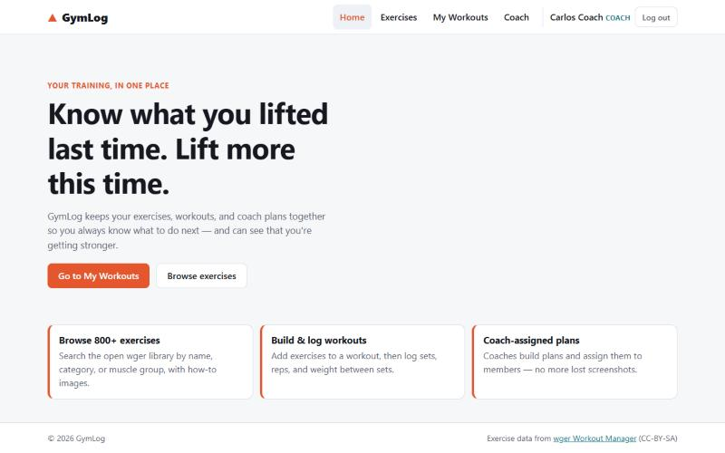
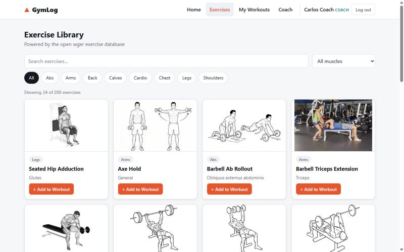
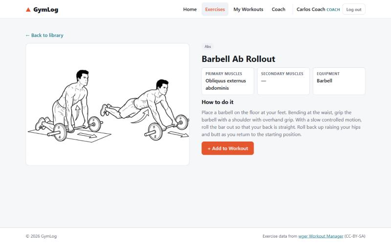
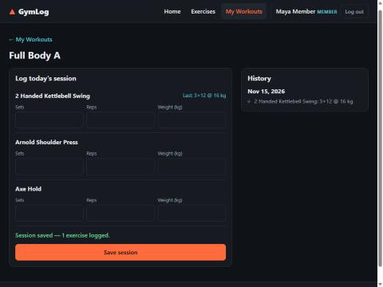
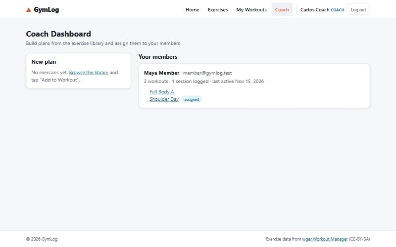
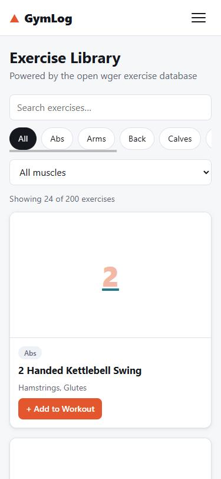
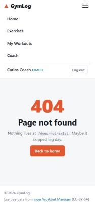

# GymLog

GymLog is a workout-tracking single-page application built with React. Gym members can browse a library of 800+ exercises, build their own workouts, and log the sets, reps, and weight they lift each session. Coaches can build workout plans and assign them to the members they train.

**Live demo:** https://YOUR-VERCEL-URL.vercel.app <!-- replace after deploying -->



## Why GymLog?

Many people at the gym track workouts in a notes app — or not at all — so they forget what weight they used last time and can't tell whether they're getting stronger. Coaches send plans through texts and screenshots that get lost. GymLog puts exercises, workouts, and coach plans in one place so members always know what to do next and can see their progress.

## Demo accounts

| Role   | Email                | Password    |
| ------ | -------------------- | ----------- |
| Member | `member@gymlog.test` | `member123` |
| Coach  | `coach@gymlog.test`  | `coach123`  |

You can also register a new member or coach account from the **Sign up** page.

## Features

- **Exercise Library** — searchable list from the wger API with category filter buttons, a muscle-group filter, client-side paging ("Show more"), and on-demand fetching of more exercises from the API.
- **Exercise Detail** — muscles, equipment, instructions, and an image gallery for each exercise.
- **Add to Workout** — one tap from any card or detail page; the navbar badge shows how many exercises are in the workout you're building.
- **My Workouts** — name and save workouts, see plans assigned by your coach, delete old workouts.
- **Workout logging** — enter sets, reps, and weight per exercise; see your last numbers next to each exercise and a full session history.
- **Coach Dashboard** — build a plan from the library, assign it to a member, and see each member's workouts, logged sessions, and last activity.
- **Role-based routes** — guests are redirected to login; only coaches can open the coach dashboard.
- **Responsive, mobile-first UI** with a hamburger menu on phones, 2-column grid on tablets, 3–4 columns on desktop, and automatic dark mode.
- **Loading, empty, and error states** with retry buttons for every API call.

## Technologies

| Purpose          | Tool                                                                        |
| ---------------- | --------------------------------------------------------------------------- |
| UI               | React 19, plain CSS (mobile-first, custom properties, media queries)        |
| Build / dev      | Vite                                                                        |
| Routing          | React Router (`react-router-dom`)                                           |
| State            | React Context API, `useState`, `useReducer`                                 |
| Data             | wger Workout Manager REST API, `fetch`                                      |
| Persistence      | `localStorage` (users, session, workouts)                                   |
| Testing          | Vitest, React Testing Library, `@testing-library/user-event`, jest-dom, jsdom |
| Linting          | oxlint                                                                      |
| Hosting          | Vercel                                                                      |

## Getting started

Requirements: Node.js 20+ and npm.

```bash
git clone https://github.com/YOUR-USERNAME/gymlog.git
cd gymlog
npm install
npm run dev        # http://localhost:5173
```

| Script               | What it does                          |
| -------------------- | ------------------------------------- |
| `npm run dev`        | Start the Vite dev server             |
| `npm run build`      | Production build into `dist/`         |
| `npm run preview`    | Serve the production build locally    |
| `npm test`           | Run the test suite once               |
| `npm run test:watch` | Run tests in watch mode               |
| `npm run lint`       | Lint with oxlint                      |

No API key or environment variables are needed — wger's exercise endpoints are public.

## Routes

| Path             | Page              | Access        | Notes                                            |
| ---------------- | ----------------- | ------------- | ------------------------------------------------ |
| `/`              | Home              | Everyone      | Intro, features, demo accounts                   |
| `/login`         | Log in            | Guests        | Redirects to My Workouts when already logged in  |
| `/register`      | Sign up           | Guests        | Choose member or coach                           |
| `/exercises`     | Exercise Library  | Everyone      | Search + category/muscle filters                 |
| `/exercises/:id` | Exercise Detail   | Everyone      | Dynamic route, uses `useParams()`                |
| `/workouts`      | My Workouts       | Logged in     | Build/save workouts, coach-assigned plans        |
| `/workouts/:id`  | Workout Detail    | Logged in     | Log sets/reps/weight, history                    |
| `/coach`         | Coach Dashboard   | Coaches only  | Build & assign plans, member overview            |
| `*`              | 404 Not Found     | Everyone      | Any unmatched URL                                |

## Project structure

```
src/
├── components/     Reusable UI: Header, Footer, Layout, Card, Button, FormField,
│                   ExerciseCard, FilterBar, WorkoutCard, DraftWorkout,
│                   AddToWorkoutButton, ProtectedRoute, PageHeader, StatusMessage
├── contexts/       AuthContext, ExerciseContext, WorkoutContext, AppProviders
├── pages/          One component per route
├── services/       wgerApi.js — all API calls
├── utils/          exercise.js (normalize/filter), storage.js (localStorage helpers)
├── test/           Test setup and render helpers
├── App.jsx         Route table
├── main.jsx        Router + providers + root render
└── index.css       Mobile-first styles
```

## State management

| Context           | Stores                                                                        | Used by                                             |
| ----------------- | ----------------------------------------------------------------------------- | --------------------------------------------------- |
| `AuthContext`     | Logged-in user and role; `login`, `logout`, `register`; list of members       | Header, ProtectedRoute, login/register, coach pages |
| `ExerciseContext` | Exercise list, categories, muscles from wger, cached after the first fetch    | Exercise Library, Exercise Detail                   |
| `WorkoutContext`  | Saved workouts, the draft being built; `addExercise`, `saveDraft`, `logSet`, `assignPlan` | Header badge, library, detail, workouts, coach |

`AuthProvider` wraps the whole app so any route can check who is logged in. `WorkoutContext` uses a pure `useReducer` reducer — every update returns new objects/arrays rather than mutating state. Local `useState` handles search text and filters, form inputs, loading/error flags, the mobile menu, and which image is shown on the detail page.

## API

GymLog reads from the [wger Workout Manager API](https://wger.de/en/software/api) (`https://wger.de/api/v2/`). No authentication is required. Exercise data is licensed CC-BY-SA by wger contributors.

| Endpoint                         | Used for                                       | Function                |
| -------------------------------- | ---------------------------------------------- | ----------------------- |
| `GET /exerciseinfo/?limit&offset`| Exercise Library (200 per batch)               | `fetchExercises()`      |
| `GET /exerciseinfo/{id}/`        | Exercise Detail when not already cached        | `fetchExercise(id)`     |
| `GET /exercisecategory/`         | Category filter buttons                        | `fetchCategories()`     |
| `GET /muscle/`                   | Muscle filter                                  | `fetchMuscles()`        |
| `GET /exerciseimage/?exercise=id`| Detail-page image gallery                      | `fetchExerciseImages()` |

Raw records are converted by `normalizeExercise()` into a flat shape (English name, plain-text description, muscle/equipment names, main image). Workouts, logs, and accounts are stored by GymLog itself, not in wger.

## Testing

```bash
npm test
```

28 tests across 4 files cover:

- **Utilities** — normalizing wger records, stripping HTML, filtering without mutation.
- **AuthContext** — login (case-insensitive email), bad password, register, duplicate email, logout.
- **WorkoutContext** — reducer immutability, duplicate prevention, save draft → workout → log session, coach assigning a plan to a member.
- **Routing** — home, 404, protected-route redirects, role check, navbar navigation.
- **User interactions** — login form errors/success, search and category filters, API loading/error/retry states, Add to Workout updating the navbar badge, and a full "add → save → log session" flow.

API calls are mocked with `vi.spyOn`, so tests don't hit the network.

## Deployment (Vercel)

1. Push this repository to GitHub.
2. In Vercel, choose **Add New → Project**, import the GitHub repo.
3. Vercel detects Vite automatically (build command `npm run build`, output `dist`). Click **Deploy**.
4. Every push to `main` redeploys automatically; pull requests get preview URLs.

`vercel.json` rewrites all paths to `index.html` so deep links like `/exercises/20` and `/workouts/...` work on refresh.

## Screenshots

| Exercise Library | Exercise Detail |
| --- | --- |
|  |  |

| Workout Detail (dark mode) | Coach Dashboard |
| --- | --- |
|  |  |

| Mobile — library | Mobile — menu & 404 |
| --- | --- |
|  |  |

## Known issues

- **Frontend-only auth.** Accounts and passwords live in the browser's `localStorage` in plain text. This is for the MVP demo only — don't use a real password.
- **Data is per-browser.** Workouts and coach assignments only exist in the browser where they were created; a coach and member must use the same browser to see each other's data.
- **Partial exercise list on first load.** The full wger list is ~7 MB, so GymLog loads 200 exercises at a time. Search and filters apply to the exercises loaded so far; use "Load more exercises from wger" to fetch more.
- Some wger exercises have no images or English description; they show a placeholder.

## Future enhancements (final submission & capstone)

- Node.js + Express REST API with PostgreSQL or MongoDB so data syncs across devices.
- Secure login with hashed passwords and JWTs, with role checks on the server.
- Server-side search across the full exercise list.
- Progress charts for each lift and personal-record (PR) notifications.
- Coach ↔ member messaging and notifications when a new plan is assigned.

## Author

Adam Elrhanjaoui
